  
  
  
  
  

  

 

## 🗺️ Quest Map

<b>📜 Open the full quest log</b>

 

**🟣 LV7 · NexLabAI**: AI Software Engineer *(Oct 2026 → now · Lahore)* 
Python/FastAPI services for AI agents, retrieval pipelines and tool-based automation. Reproducible benchmarks for frontier LLMs, evaluation datasets with reference outputs, MCP-enabled agent loops.

**🔵 LV6 · IronSight Technologies**: Project Manager, AI & Data Integration *(Oct 2025 – Sep 2026 · New York, remote)* 
Led delivery of a high-volume connector platform for IoT, security and enterprise data on ECS Fargate, Lambda and ALB. Helped build an LLM field mapper that uses RAG over schema definitions and validates every mapping before data moves.

**🟡 LV5 · MY State MLS**: Technical Team Lead *(Apr 2023 – Sep 2025 · Florida, remote)* · **boss level** 
Cut form conversion from 60 to 10 minutes (−83%) with LLM-assisted document processing and RAG over 2,000+ production forms. Built release gates with golden datasets and regression tests. Led four engineers and one QA engineer.

**🔵 LV4 · Realtxr**: Full-Stack Engineer, sole developer *(Feb 2022 – Mar 2023 · Florida, remote)* 
Built and ran a two-sided real-estate marketplace solo. Listing creation went from ~20 minutes to under 5. Transaction-safe booking, indexed search, Stripe and S3.

**🔵 LV3 · Oase International**: Software Engineer *(Jun 2019 – Jan 2022 · Germany, remote)* 
Inventory and sales-management platform; redesigned schemas and indexes for reporting.

**🔵 LV2 · Coduko**: Software Engineer *(Jul 2017 – May 2019 · Lahore)* 
Reverse-engineered an undocumented production database; PHP/Laravel services for international clients.

**🔵 LV1 · Devsinc**: Software Engineering Intern *(Jan – Apr 2017 · Lahore)* 
Ruby on Rails features in an Agile team.

**🎓 Training grounds**: BSCS, University of Central Punjab *(2017)*

 

## ⚔️ Current Quests

| | Quest | Status |
|:--:|:--|:--|
| 🟢 | **Main quest:** Python/FastAPI services for AI agents, retrieval pipelines and tool automation at NexLabAI | `IN PROGRESS` |
| 🟣 | **Side quest:** reproducible benchmarks for frontier LLMs, comparing task success across context and inference settings | `IN PROGRESS` |
| 🟡 | **Side quest:** Terminal-Bench-style math reasoning tasks with automated graders, GPT vs Claude | `GRINDING` |
| 🔵 | **Daily:** prototyping MCP-enabled agent loops and testing tool selection | `REPEATABLE` |

 

## 🏆 Achievements

  
  

 

 

## 🎒 Inventory

| Slot | Gear |
|:--|:--|
| ⚔️ **Main weapon** | Python · FastAPI · SQL · PHP · Laravel · TypeScript · REST APIs · async jobs |
| 🔮 **Magic** | OpenAI & Anthropic APIs · RAG · embeddings · Qdrant · structured outputs · tool calling · MCP · n8n |
| 🎯 **Accuracy** | LLM benchmarking · automated grading · golden datasets · regression tests · training-data prep |
| 🛡️ **Armor** | PostgreSQL · MySQL · AWS ECS Fargate · Lambda · ALB · S3 · SES · Docker · CI/CD |
| 🧩 **Accessories** | React · Stripe · webhooks · third-party APIs · auth |

 

## 🐍 Boss Fight: The Contribution Snake

 

## 🎮 Join the Party

 

📍 Lahore, Pakistan · UTC+05:00 · <a href="mailto:m.mogheesasif@gmail.com">m.mogheesasif@gmail.com</a>

  

